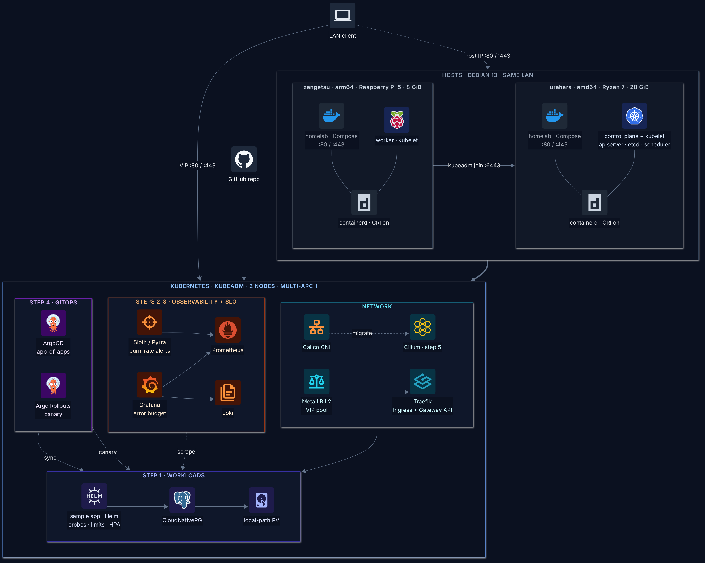

# Kubernetes lab: local

## Goal

Build a Kubernetes cluster from scratch with kubeadm on two homelab servers, then run real workloads on it with observability, SLOs and GitOps. Every step is done by hand first, to learn how each part works. It also serves as CKA preparation.

## Diagram



Source: [diagram.mmd](diagram.mmd). Render with `tools/diagram/render.sh k8s/local`.

## Prerequisites

| Node | Hardware | CPU | RAM | Disk | OS |
|---|---|---|---|---|---|
| urahara | GMKtec NucBox K8 | AMD Ryzen 7 8845HS, 8C/16T (amd64) | 28 GiB | NVMe | Debian 13 |
| zangetsu | Raspberry Pi 5 | ARM Cortex-A76, 4 cores (arm64) | 8 GiB | NVMe | Debian 13 |

Both servers also run other services with Docker Compose on ports 80 and 443. The cluster must live next to them.

Tool versions are recorded in each step.

## Steps

| # | Step | Status |
|---|---|---|
| 0 | Diagram | done |
| 1 | Cluster and workloads | in progress |
| 2 | Observability | planned |
| 3 | SLI, SLO and error budget | planned |
| 4 | GitOps and progressive delivery | planned |
| 5 | CNI migration: Calico to Cilium | planned |

### 0. Diagram

Architecture drawn before any install. Reviewed and approved on 2026-11-05. Decisions:

| ADR | Decision |
|---|---|
| [0001](docs/adr/0001-kubeadm.md) | Build the cluster with kubeadm |
| [0002](docs/adr/0002-shared-containerd-with-cri.md) | Use Docker's containerd with the CRI plugin enabled |
| [0003](docs/adr/0003-multi-arch-images.md) | Multi-arch images by default, node affinity when needed |
| [0004](docs/adr/0004-calico-then-cilium.md) | Calico first, migrate to Cilium in step 5 |
| [0005](docs/adr/0005-metallb-l2.md) | MetalLB in L2 mode for LoadBalancer IPs |
| [0006](docs/adr/0006-local-path-storage.md) | local-path-provisioner for persistent volumes |
| [0007](docs/adr/0007-untainted-control-plane.md) | Run workloads on the control plane node |
| [0008](docs/adr/0008-traefik.md) | Traefik as Ingress and Gateway API controller |
| [0009](docs/adr/0009-cloudnativepg.md) | CloudNativePG as the database operator |
| [0010](docs/adr/0010-install-1-36-then-upgrade.md) | Install Kubernetes 1.36, then upgrade to 1.37 (added in step 1) |
| [0011](docs/adr/0011-nftables-dataplane.md) | nftables data plane for kube-proxy and Calico (added in step 1) |
| [0012](docs/adr/0012-docker-user-accept-pod-cidr.md) | Accept pod traffic in Docker's DOCKER-USER chain (added in step 1) |
| [0013](docs/adr/0013-urahara-announces-lb-ips.md) | urahara can announce LoadBalancer IPs (added in step 1) |

### 1. Cluster and workloads

#### 1.1 Preflight

Read-only checks on both nodes before any change. On Debian, `sysctl` and `swapon` live in `/usr/sbin`, which is not in a normal user's PATH: run them with `sudo` or read `/proc` directly.

```bash
nproc; free -h; df -h /
cat /proc/swaps
sudo ss -tlnp | grep -E ':(80|443|6443|10250) '
lsmod | grep -E 'overlay|br_netfilter'
sudo sysctl net.ipv4.ip_forward net.bridge.bridge-nf-call-iptables
containerd config dump | grep -A2 disabled_plugins
```

Results (2026-11-05):

| Check | urahara | zangetsu | Needed for kubeadm |
|---|---|---|---|
| CPU / RAM available | 16 threads / 19 GiB | 4 cores / 4.6 GiB | 2 CPU / 2 GiB minimum |
| Swap | 28 GiB disk partition, on | 2 GiB zram, on | off (default kubelet config) |
| Ports 80/443 | 80 used by Docker (node IP only) | 80 and 443 used by Docker (all addresses) | free for Traefik only if it uses hostPort; with MetalLB IPs it does not conflict |
| Ports 6443/10250 | free | free | free |
| `overlay` module | loaded | loaded | loaded |
| `br_netfilter` module | not loaded | not loaded | loaded |
| `net.ipv4.ip_forward` | 1 | 1 | 1 |
| `bridge-nf-call-iptables` | missing (module not loaded) | missing (module not loaded) | 1 |
| containerd CRI plugin | disabled | disabled | enabled (ADR 0002) |

To fix before `kubeadm init`: swap, `br_netfilter` and its sysctls, and the CRI plugin.

#### 1.2 Kernel modules and sysctl

Load `br_netfilter` now and on every boot, and set the network values kubeadm checks. Run on both nodes.

```bash
cat <<EOF | sudo tee /etc/modules-load.d/k8s.conf
overlay
br_netfilter
EOF
sudo modprobe br_netfilter

cat <<EOF | sudo tee /etc/sysctl.d/99-k8s.conf
net.bridge.bridge-nf-call-iptables  = 1
net.bridge.bridge-nf-call-ip6tables = 1
net.ipv4.ip_forward                 = 1
EOF
sudo sysctl --system | grep -E 'bridge-nf|ip_forward'
```

Expected: the three values show `= 1`. `bridge-nf-call-iptables` also changes how Docker bridge traffic is filtered, so check the Compose services after the change:

```bash
docker ps --format '{{.Names}}\t{{.Status}}' | head
```

urahara and zangetsu (2026-11-05): all three values `= 1`, all containers still up.

#### 1.3 Swap off

kubelet does not start with swap on (default config). Each node creates swap in a different way, so each needs a different fix.

urahara: swap partition in `/etc/fstab`.

```bash
sudo swapoff -a
sudo cp /etc/fstab /etc/fstab.bak
sudo sed -i '/\sswap\s/ s/^/#/' /etc/fstab
sudo systemctl daemon-reload
grep swap /etc/fstab
cat /proc/swaps
```

Expected: the swap line in fstab starts with `#`, and `/proc/swaps` shows only the header.

fstab may not be the only source. On urahara, systemd also activates the partition by its GPT type (`systemd-gpt-auto-generator`), so check what systemd loaded with `systemctl list-units --type=swap --all` and see step 1.13.

zangetsu: zram created at boot by `rpi-swap` (Raspberry Pi OS on Debian 13), configured in `/etc/rpi/swap.conf`. Swap is turned off with a drop-in, which survives package updates.

```bash
sudo mkdir -p /etc/rpi/swap.conf.d
printf '[Main]\nMechanism=none\n' | sudo tee /etc/rpi/swap.conf.d/90-k8s-no-swap.conf
sudo swapoff -a
cat /proc/swaps
```

Finding (2026-11-05): on zangetsu, `swapoff -a` failed with `Cannot allocate memory`. The kernel moved part of the swap back to RAM (about 520 MB down to 110 MB) and then stopped, because there was not enough free RAM for the rest. The drop-in is already in place, so a reboot starts the node with no swap. Lesson: the Raspberry Pi has little memory headroom with the current Docker services, which matters for scheduling (ADR 0003, node affinity).

Fix: reboot zangetsu. After the reboot (2026-11-05), `/proc/swaps` shows only the header on both nodes, zangetsu has 5.1 GiB available, and all Docker containers came back.

#### 1.4 Container runtime (ADR 0002)

Align containerd on both nodes and enable the CRI plugin, in one restart per node. Both nodes had different versions (2.3.3 and 2.2.6). After `sudo apt update`, the Docker repo has 2.4.2-3 for amd64 and arm64, so both nodes upgrade to it:

```bash
apt-cache madison containerd.io | head -6
```

Then, one node at a time:

```bash
sudo cp /etc/containerd/config.toml /etc/containerd/config.toml.bak
sudo apt install -y -o Dpkg::Options::="--force-confold" containerd.io=2.4.2-3~debian.13~trixie
sudo apt-mark hold containerd.io

containerd config default | sudo tee /etc/containerd/config.toml >/dev/null
sudo sed -i 's/SystemdCgroup = false/SystemdCgroup = true/' /etc/containerd/config.toml
grep -nE 'SystemdCgroup|disabled_plugins' /etc/containerd/config.toml

sudo systemctl restart containerd
containerd --version
sudo ctr plugins ls | grep -i cri
docker ps --format '{{.Names}}\t{{.Status}}' | head
```

- `--force-confold` keeps Docker's config during the install; it is replaced right after with the full default, where CRI is enabled.
- `apt-mark hold` stops an `apt upgrade` from changing the Kubernetes runtime by surprise.
- Expected: `disabled_plugins = []`, `SystemdCgroup = true`, version 2.4.2, the three CRI plugins with status `ok`, Docker containers still up. A containerd restart does not stop running containers: each one has its own shim.

urahara and zangetsu (2026-11-05): all as expected. Both nodes run containerd 2.4.2-3 with CRI enabled, held.

Incident: rebooting zangetsu in step 1.3 restarted CrowdSec on urahara, which reads logs from Loki on zangetsu. Postmortem: [PM-0001](docs/postmortems/0001-crowdsec-restart-after-node-reboot.md).

#### 1.5 kubeadm, kubelet and kubectl (ADR 0010)

Add the Kubernetes apt repo for 1.36. The minor version is part of the URL, so apt only sees 1.36 packages. Run on both nodes.

```bash
sudo apt-get install -y apt-transport-https ca-certificates curl gpg
sudo mkdir -p -m 755 /etc/apt/keyrings
curl -fsSL https://pkgs.k8s.io/core:/stable:/v1.36/deb/Release.key | sudo gpg --dearmor -o /etc/apt/keyrings/kubernetes-apt-keyring.gpg
echo 'deb [signed-by=/etc/apt/keyrings/kubernetes-apt-keyring.gpg] https://pkgs.k8s.io/core:/stable:/v1.36/deb/ /' | sudo tee /etc/apt/sources.list.d/kubernetes.list
sudo apt-get update
apt-cache madison kubeadm | head -3
```

Both nodes (2026-11-05): latest patch is 1.36.6-1.1, so both install exactly that version and hold it:

```bash
sudo apt-get install -y kubelet=1.36.6-1.1 kubeadm=1.36.6-1.1 kubectl=1.36.6-1.1
sudo apt-mark hold kubelet kubeadm kubectl
sudo systemctl enable kubelet
kubeadm version -o short
kubectl version --client
systemctl status kubelet --no-pager | head -5
```

Expected: version v1.36.6 for kubeadm and kubectl. kubelet shows `inactive (dead)`: `systemctl enable` without `--now` only enables it for boot, and `kubeadm init` starts it.

#### 1.6 Control plane on urahara (`kubeadm init`)

A plain `kubeadm init` would use defaults that do not fit this lab: no pod CIDR (Calico needs `10.244.0.0/16`, ADR 0004) and an automatic node IP (the node has a second, unused Ethernet port). It also needs `sudo`: run without it, the preflight stops with `[ERROR IsPrivilegedUser]`.

So the cluster starts from a config file. `<URAHARA_IP>` is the node's LAN IP.

```bash
cat <<'EOF' > ~/kubeadm-config.yaml
apiVersion: kubeadm.k8s.io/v1beta4
kind: InitConfiguration
localAPIEndpoint:
  advertiseAddress: <URAHARA_IP>
  bindPort: 6443
nodeRegistration:
  name: urahara
  criSocket: unix:///run/containerd/containerd.sock
  kubeletExtraArgs:
    - name: node-ip
      value: <URAHARA_IP>
---
apiVersion: kubeadm.k8s.io/v1beta4
kind: ClusterConfiguration
kubernetesVersion: v1.36.6
clusterName: lab-local
controlPlaneEndpoint: <URAHARA_IP>:6443
networking:
  podSubnet: 10.244.0.0/16
  serviceSubnet: 10.96.0.0/12
---
apiVersion: kubelet.config.k8s.io/v1beta1
kind: KubeletConfiguration
cgroupDriver: systemd
EOF

kubeadm config validate --config ~/kubeadm-config.yaml
sudo kubeadm config images pull --config ~/kubeadm-config.yaml
sudo kubeadm init --config ~/kubeadm-config.yaml
```

- `kubernetesVersion` is fixed, so kubeadm does not look up the newest release online.
- `cgroupDriver: systemd` matches `SystemdCgroup = true` in containerd (step 1.4).
- Images pulled for 1.36.6: kube-apiserver, kube-controller-manager, kube-scheduler, kube-proxy v1.36.6, coredns v1.14.2, pause 3.10.2, etcd 3.6.8-0.

urahara (2026-11-05): `Your Kubernetes control-plane has initialized successfully!` The API server certificate covers the node IP and the first service IP (`10.96.0.1`). The output ends with a `kubeadm join` command with a token and a CA hash: keep it out of Git, the token expires in 24 hours.

#### 1.7 kubectl access and control-plane taint (ADR 0007)

```bash
mkdir -p $HOME/.kube
sudo cp -i /etc/kubernetes/admin.conf $HOME/.kube/config
sudo chown $(id -u):$(id -g) $HOME/.kube/config

kubectl get nodes -o wide
kubectl get pods -n kube-system -o wide
kubectl taint nodes urahara node-role.kubernetes.io/control-plane:NoSchedule-
```

urahara (2026-11-05): node `NotReady` (no CNI yet), INTERNAL-IP is the main port, runtime `containerd://2.4.2`. etcd, kube-apiserver, kube-controller-manager, kube-scheduler and kube-proxy `Running`; both CoreDNS pods `Pending` until the CNI is installed. Taint removed: `node/urahara untainted`.

#### 1.8 Join zangetsu

The join also uses a config file, so the node IP is explicit. `<TOKEN>` and `<CA_HASH>` come from the `kubeadm init` output and stay out of Git.

```bash
cat <<'EOF' > ~/kubeadm-join.yaml
apiVersion: kubeadm.k8s.io/v1beta4
kind: JoinConfiguration
discovery:
  bootstrapToken:
    apiServerEndpoint: <URAHARA_IP>:6443
    token: <TOKEN>
    caCertHashes:
      - sha256:<CA_HASH>
nodeRegistration:
  name: zangetsu
  criSocket: unix:///run/containerd/containerd.sock
  kubeletExtraArgs:
    - name: node-ip
      value: <ZANGETSU_IP>
EOF

sudo kubeadm join --config ~/kubeadm-join.yaml
```

zangetsu (2026-11-05): `This node has joined the cluster`. Two warnings, both harmless: `missing optional cgroups: hugetlb` (the Raspberry Pi kernel has no hugetlb cgroup; nothing in the lab uses huge pages) and the kube-proxy `bindAddress` recommendation (`::` instead of `0.0.0.0`, only relevant for IPv6). Both nodes show `NotReady` until Calico is up.

#### 1.9 Calico (ADR 0004)

Latest Calico release on 2026-11-05:

```bash
curl -s https://api.github.com/repos/projectcalico/calico/releases/latest | grep tag_name
```

`v3.33.0`. Install the operator, then the Installation from [manifests/calico-installation.yaml](manifests/calico-installation.yaml):

```bash
kubectl create -f https://raw.githubusercontent.com/projectcalico/calico/v3.33.0/manifests/operator-crds.yaml
kubectl create -f https://raw.githubusercontent.com/projectcalico/calico/v3.33.0/manifests/tigera-operator.yaml
kubectl create -f calico-installation.yaml
watch kubectl get tigerastatus
```

Result (2026-11-05): everything available on urahara, but `calico` stayed `PROGRESSING` and calico-node on zangetsu stayed `0/1`. Felix panicked on every start: `iptables-nft-save failed because there are incompatible nft rules in the table nat`. Cause: Tailscale on zangetsu runs in forced nftables mode and adds native nftables rules to the shared `ip nat` table, which the iptables inside the calico-node image cannot read. Tailscale cannot use iptables mode on that kernel (no legacy `ip_tables`). Decision: move the cluster to nftables, see ADR 0011.

Note: `kubectl` on zangetsu fails with `the server could not find the requested resource`. Workers have no kubeconfig, so kubectl falls back to `localhost:8080`, where an unrelated Docker service answers. Run kubectl on urahara.

#### 1.10 Switch to the nftables data plane (ADR 0011)

kube-proxy first, because Calico's nftables mode requires it.

```bash
kubectl -n kube-system get configmap kube-proxy -o yaml | grep 'mode:'
kubectl -n kube-system get configmap kube-proxy -o yaml | sed 's/mode: ""/mode: "nftables"/' | kubectl apply -f -
kubectl -n kube-system get configmap kube-proxy -o yaml | grep 'mode:'
kubectl -n kube-system rollout restart daemonset/kube-proxy
kubectl -n kube-system rollout status daemonset/kube-proxy
kubectl -n kube-system logs daemonset/kube-proxy | grep -i -m3 nftables
```

Then Calico:

```bash
kubectl patch installation default --type=merge -p '{"spec":{"calicoNetwork":{"linuxDataplane":"Nftables"}}}'
watch kubectl get tigerastatus
```

The operator only changes the Felix configuration: Felix reloads inside the running calico-node pods, so pod names and ages do not change. With `NFTablesMode: Auto`, Felix follows the kube-proxy mode.

Check on a node and from urahara:

```bash
sudo nft list tables
kubectl get installation default -o jsonpath='{.spec.calicoNetwork.linuxDataplane}{"\n"}'
kubectl logs -n calico-system <calico-node-pod> -c calico-node --since=2m | grep -iE 'panic|incompatible'
```

Result (2026-11-05): new tables `ip calico`, `ip kube-proxy` and `ip6 kube-proxy`; no Felix errors since the switch; calico-node `1/1` on both nodes with no new restarts.

Leftovers: the old kube-proxy iptables chains (`KUBE-SVC-*`, `KUBE-SEP-*`, `KUBE-NODEPORTS`, `KUBE-MARK-MASQ` and others) stay in `ip nat` and `ip filter`. kube-proxy does not remove them when it switches modes. `KUBE-KUBELET-CANARY` and `KUBE-FIREWALL` belong to kubelet and stay.

Check that no base chain jumps to them (only kubelet's `KUBE-FIREWALL` should show), on both nodes:

```bash
for c in PREROUTING OUTPUT POSTROUTING; do sudo nft list chain ip nat $c | grep -E 'jump KUBE'; done
for c in INPUT FORWARD OUTPUT; do sudo nft list chain ip filter $c | grep -E 'jump KUBE'; done
```

List the orphan chains (dry run), then flush and delete them. kubelet's chains are excluded:

```bash
for t in "ip nat" "ip filter" "ip6 nat" "ip6 filter"; do
  echo "== $t"
  sudo nft list table $t 2>/dev/null | awk '/^[[:space:]]*chain KUBE-/{print $2}' | grep -vE '^KUBE-(FIREWALL|KUBELET-CANARY)$'
done

for t in "ip nat" "ip filter" "ip6 nat" "ip6 filter"; do
  chains=$(sudo nft list table $t 2>/dev/null | awk '/^[[:space:]]*chain KUBE-/{print $2}' | grep -vE '^KUBE-(FIREWALL|KUBELET-CANARY)$')
  for c in $chains; do sudo nft flush chain $t "$c"; done
  for c in $chains; do sudo nft delete chain $t "$c"; done
done
sudo nft list ruleset | grep -E 'chain KUBE-'
```

Result (2026-11-05): urahara had no leftovers (kube-proxy cleaned up there, because iptables can read its `ip nat`). zangetsu had 19 chains in `ip nat`, 4 in `ip filter` and a few in the ip6 tables, all removed. Only `KUBE-FIREWALL`, `KUBE-KUBELET-CANARY` and `KUBE-IPTABLES-HINT` remain. All pods `Running`, Docker containers up on both nodes.

Postmortem: [PM-0002](docs/postmortems/0002-calico-node-crash-nftables-rules.md).

#### 1.11 Smoke test: pod-to-pod across nodes and DNS

`Ready` nodes do not prove the pod network works. One pod on each node, then ping both ways and resolve a Service name from zangetsu (CoreDNS runs on urahara):

```bash
kubectl run net-a --image=busybox:1.36 --restart=Never --overrides='{"spec":{"nodeName":"urahara"}}' -- sleep 3600
kubectl run net-b --image=busybox:1.36 --restart=Never --overrides='{"spec":{"nodeName":"zangetsu"}}' -- sleep 3600
kubectl wait --for=condition=Ready pod/net-a pod/net-b --timeout=120s
kubectl get pods -o wide

kubectl exec net-a -- ping -c3 "$(kubectl get pod net-b -o jsonpath='{.status.podIP}')"
kubectl exec net-b -- ping -c3 "$(kubectl get pod net-a -o jsonpath='{.status.podIP}')"
kubectl exec net-b -- nslookup kubernetes.default.svc.cluster.local
```

First result (2026-11-05): 100% packet loss both ways, DNS `connection timed out`. Cause: Docker's `FORWARD` policy `drop` on urahara. In nftables mode, Calico's own table cannot override it (ADR 0012).

```bash
sudo nft list chain ip filter FORWARD | head -8
sudo nft list chain ip filter DOCKER-USER
```

urahara: `policy drop`. zangetsu: `policy accept` (forwarding was already on when Docker started). Temporary test on urahara, in memory only:

```bash
sudo nft insert rule ip filter DOCKER-USER ip saddr 10.244.0.0/16 accept
sudo nft insert rule ip filter DOCKER-USER ip daddr 10.244.0.0/16 accept
```

After it: ping `0% packet loss` (about 0.3 ms), and `nslookup` answers `10.96.0.1` through `10.96.0.10`.

#### 1.12 Make the DOCKER-USER rules permanent (ADR 0012)

On both nodes:

```bash
sudo tee /usr/local/sbin/k8s-docker-user.sh >/dev/null <<'EOF'
#!/bin/sh
# Accept Kubernetes pod traffic in Docker's DOCKER-USER chain (ADR 0012).
set -eu
CIDR=10.244.0.0/16
for dir in saddr daddr; do
  nft list chain ip filter DOCKER-USER | grep -q "ip $dir $CIDR accept" \
    || nft insert rule ip filter DOCKER-USER ip "$dir" "$CIDR" accept
done
EOF
sudo chmod 755 /usr/local/sbin/k8s-docker-user.sh

sudo tee /etc/systemd/system/k8s-docker-user.service >/dev/null <<'EOF'
[Unit]
Description=Accept Kubernetes pod traffic in Docker's DOCKER-USER chain
After=docker.service
Requires=docker.service
PartOf=docker.service

[Service]
Type=oneshot
ExecStart=/usr/local/sbin/k8s-docker-user.sh
RemainAfterExit=yes

[Install]
WantedBy=docker.service
EOF

sudo systemctl daemon-reload
sudo systemctl enable --now k8s-docker-user.service
systemctl status k8s-docker-user.service --no-pager | head -4
sudo nft list chain ip filter DOCKER-USER
```

The script is idempotent: if the rules already exist (like the temporary ones on urahara), it does not add them again.

Smoke test again after the unit (2026-11-05): ping `0% packet loss` both ways (about 0.3 ms), `nslookup` answers `10.96.0.1`. The pod network works across both nodes.

Postmortem: [PM-0003](docs/postmortems/0003-pod-traffic-dropped-by-docker-forward.md).

#### 1.13 Drill: reboot both nodes

Everything above was applied at runtime. A reboot shows what is really persistent. One node at a time, worker first.

zangetsu:

```bash
kubectl drain zangetsu --ignore-daemonsets --delete-emptydir-data   # on urahara
sudo reboot                                                          # on zangetsu
```

After the boot, on the node:

```bash
cat /proc/swaps
lsmod | grep -c br_netfilter
sudo sysctl net.bridge.bridge-nf-call-iptables net.ipv4.ip_forward
systemctl is-active containerd kubelet k8s-docker-user
sudo nft list chain ip filter FORWARD | grep policy
sudo nft list chain ip filter DOCKER-USER | grep -c 10.244.0.0/16
```

Then `kubectl uncordon zangetsu` on urahara. zangetsu (2026-11-05): all checks pass, node `Ready`. As expected, CrowdSec on urahara restarted while Loki was down (PM-0001).

urahara (the only control plane, no drain): after the reboot, `kubectl` got `connection refused`. Swap was on again, and kubelet refused to start. Cause: `systemd-gpt-auto-generator` activates the swap partition by its GPT type, without fstab. Check what systemd loaded, and turn the generator off:

```bash
systemctl list-units --type=swap --all --no-pager
sudo swapoff -a
sudo systemctl mask dev-nvme0n1p3.swap
sudo cp /etc/default/grub /etc/default/grub.bak
sudo sed -i 's/^GRUB_CMDLINE_LINUX_DEFAULT="\(.*\)"/GRUB_CMDLINE_LINUX_DEFAULT="\1 systemd.gpt_auto=0"/' /etc/default/grub
sudo update-grub
sudo reboot
```

After the second reboot: no swap, `systemd.gpt_auto=0` in `/proc/cmdline`, both nodes `Ready`. Postmortem: [PM-0004](docs/postmortems/0004-swap-back-after-reboot.md).

Note: right after boot, `k8s-docker-user` shows `inactive` until Docker starts (on urahara, about 2 minutes after boot), then `active (exited)`. That is expected: the unit is wanted by `docker.service`. After the reboot, urahara's `FORWARD` policy was `accept`, because the sysctl turns forwarding on before Docker starts; the `DOCKER-USER` rules were present anyway.

Smoke test after both reboots (2026-11-05, step 1.11 commands): ping `0% packet loss` both ways, `nslookup` answers `10.96.0.1`. The base cluster is persistent.

#### 1.14 MetalLB (ADR 0005)

Preflight, read-only. Check that the planned pool IPs are free on the LAN: ping finds devices that answer ICMP, and the ARP table finds devices that block ping. `REACHABLE` or `STALE` with a MAC address means in use; `FAILED` or `INCOMPLETE` means free.

```bash
for i in $(seq 241 249); do
  ping -c1 -W1 <LAN_PREFIX>.$i >/dev/null 2>&1 && echo "<LAN_PREFIX>.$i  answers ping (IN USE)" || echo "<LAN_PREFIX>.$i  no ping"
done
ip neigh show | grep -E '<LAN_PREFIX>\.24[1-9] '
sudo ss -tulnp | grep 7946    # memberlist port of the MetalLB speaker, on both nodes
curl -s https://api.github.com/repos/metallb/metallb/releases/latest | grep tag_name
```

Result (2026-11-05): `.241` to `.247` and `.249` free; `.248` answers ping and ARP (a device with a Raspberry Pi MAC), so it is excluded. Pool: `.241` to `.247` (7 IPs). Port 7946 free. Latest MetalLB: `v0.16.2`.

kube-proxy in nftables mode needs no extra setting for MetalLB L2. The `strictARP` change found in many guides is only for IPVS mode.

Install (official manifest), then the pool from [manifests/metallb-pool.yaml](manifests/metallb-pool.yaml). Wait for the controller before applying the pool: the pool is validated by MetalLB's webhook.

```bash
kubectl apply -f https://raw.githubusercontent.com/metallb/metallb/v0.16.2/config/manifests/metallb-native.yaml
kubectl -n metallb-system wait --for=condition=Ready pod --all --timeout=180s
kubectl -n metallb-system get pods -o wide
kubectl apply -f metallb-pool.yaml
kubectl -n metallb-system get ipaddresspools,l2advertisements
```

Result (2026-11-05): controller and pool fine; the speaker on zangetsu in `CrashLoopBackOff`. Its log (`kubectl -n metallb-system logs <speaker-pod> --previous`) ends with:

```
failed to start metrics server: listen tcp 0.0.0.0:9120: bind: address already in use
```

The speaker runs with `hostNetwork`, so its metrics port competes with the host's ports. A Docker container on zangetsu publishes 9120, and another one on urahara publishes 9121. 7472 (MetalLB's old default) is free on both, so the speaker moves there:

```bash
sudo ss -tlnp | grep -E ':(9120|9121|7472) '    # on both nodes

kubectl -n metallb-system patch daemonset speaker --type=json -p='[
  {"op":"replace","path":"/spec/template/spec/containers/0/args/0","value":"--port=7472"},
  {"op":"replace","path":"/spec/template/spec/containers/0/ports/0/containerPort","value":7472},
  {"op":"replace","path":"/spec/template/metadata/annotations/prometheus.io~1port","value":"7472"}
]'
kubectl -n metallb-system rollout status daemonset/speaker
```

Both speakers `1/1 Running`. This patch differs from the upstream manifest: re-applying the official file undoes it. In step 4 (GitOps) it becomes a Kustomize patch.

Lesson: every `hostNetwork` component needs a port check on every node before install. Ports used by MetalLB on the nodes: 7946 TCP/UDP (memberlist), 7472 (metrics), 17472 (health probe, localhost).

#### 1.15 LoadBalancer test and failover drill

A test Service with `type: LoadBalancer`:

```bash
kubectl create deployment lb-test --image=nginx:alpine --replicas=2
kubectl expose deployment lb-test --type=LoadBalancer --port=80
kubectl rollout status deployment/lb-test
kubectl get pods -l app=lb-test -o wide
kubectl get svc lb-test
kubectl get servicel2statuses -n metallb-system
curl -sI http://<FIRST_POOL_IP> | head -1
```

Result (2026-11-05): `EXTERNAL-IP` is the first IP of the pool, one nginx pod per node, `HTTP/1.1 200 OK`. zangetsu announces the IP.

Failover drill: a request loop on a PC on the LAN (PowerShell), then reboot the node that announces the IP.

```powershell
while ($true) { try { $r = Invoke-WebRequest http://<FIRST_POOL_IP> -TimeoutSec 2 -UseBasicParsing; "$(Get-Date -f HH:mm:ss) $($r.StatusCode)" } catch { "$(Get-Date -f HH:mm:ss) FAIL" }; Start-Sleep 1 }
```

```bash
kubectl drain zangetsu --ignore-daemonsets --delete-emptydir-data    # on urahara
sudo reboot                                                           # on zangetsu
kubectl get servicel2statuses -n metallb-system                       # on urahara, during the reboot
kubectl uncordon zangetsu                                             # on urahara, after the boot
```

First run: about 75 seconds of failed requests, and the IP never moved to urahara. kubeadm labels the control plane with `node.kubernetes.io/exclude-from-external-load-balancers`, and MetalLB does not announce from it (PM-0005). Fix (ADR 0013):

```bash
kubectl get node urahara --show-labels | tr ',' '\n' | grep exclude
kubectl label node urahara node.kubernetes.io/exclude-from-external-load-balancers-
```

Second run: urahara takes over the IP during the reboot, no failed requests.

#### 1.16 Storage: local-path-provisioner (ADR 0006)

Preflight on both nodes: free space on `/opt`, and the default volume directory does not exist yet.

```bash
df -h /opt
ls -ld /opt/local-path-provisioner 2>&1
```

Result (2026-11-06): 753 GB free on urahara, 355 GB on zangetsu; the directory does not exist on either node.

Install the latest release and make it the default StorageClass:

```bash
TAG=$(curl -s https://api.github.com/repos/rancher/local-path-provisioner/releases/latest | grep -m1 '"tag_name"' | cut -d'"' -f4); echo "$TAG"
kubectl apply -f "https://raw.githubusercontent.com/rancher/local-path-provisioner/${TAG}/deploy/local-path-storage.yaml"
kubectl -n local-path-storage rollout status deployment/local-path-provisioner
kubectl patch storageclass local-path -p '{"metadata":{"annotations":{"storageclass.kubernetes.io/is-default-class":"true"}}}'
kubectl get storageclass
```

Result: `v0.0.37`; `local-path (default)`, reclaim policy `Delete`, binding mode `WaitForFirstConsumer`, no volume expansion.

Test: a PVC and a pod that writes a file into it.

```bash
cat <<'EOF' | kubectl apply -f -
apiVersion: v1
kind: PersistentVolumeClaim
metadata:
  name: pv-test
spec:
  accessModes: ["ReadWriteOnce"]
  resources:
    requests:
      storage: 100Mi
---
apiVersion: v1
kind: Pod
metadata:
  name: pv-writer
spec:
  containers:
    - name: writer
      image: busybox:1.36
      command: ["sh", "-c", "date > /data/hello.txt && sleep 3600"]
      volumeMounts:
        - name: data
          mountPath: /data
  volumes:
    - name: data
      persistentVolumeClaim:
        claimName: pv-test
EOF
kubectl wait --for=condition=Ready pod/pv-writer --timeout=120s
kubectl get pvc pv-test
kubectl get pod pv-writer -o wide
kubectl exec pv-writer -- cat /data/hello.txt
```

Result: PVC `Bound` (100Mi, `local-path`), pod `Running` on urahara, the file has the date.

Persistence test: delete the pod and read the file from a new pod. A new reader pod, not the writer again, because the writer would overwrite the file.

```bash
kubectl describe pv "$(kubectl get pvc pv-test -o jsonpath='{.spec.volumeName}')" | grep -E -A4 'Node Affinity|Source'
sudo cat /opt/local-path-provisioner/*pv-test*/hello.txt

kubectl delete pod pv-writer
cat <<'EOF' | kubectl apply -f -
apiVersion: v1
kind: Pod
metadata:
  name: pv-reader
spec:
  containers:
    - name: reader
      image: busybox:1.36
      command: ["sh", "-c", "cat /data/hello.txt && sleep 3600"]
      volumeMounts:
        - name: data
          mountPath: /data
  volumes:
    - name: data
      persistentVolumeClaim:
        claimName: pv-test
EOF
kubectl wait --for=condition=Ready pod/pv-reader --timeout=120s
kubectl get pod pv-reader -o wide
kubectl logs pv-reader
```

Result (2026-11-06): the PV has node affinity `kubernetes.io/hostname in [urahara]` and is a `HostPath` directory under `/opt/local-path-provisioner/`. The host sees the same file. `pv-reader` was scheduled on urahara without any node selector (the scheduler follows the PV's node affinity) and printed the same date as the writer. The data survived the pod.

### 2. Observability

Planned.

### 3. SLI, SLO and error budget

Planned.

### 4. GitOps and progressive delivery

Planned.

### 5. CNI migration: Calico to Cilium

Planned.

## Postmortems

| ID | Date | Title | Severity |
|---|---|---|---|
| [PM-0001](docs/postmortems/0001-crowdsec-restart-after-node-reboot.md) | 2026-11-05 | CrowdSec restarted on urahara after zangetsu reboot | low |
| [PM-0002](docs/postmortems/0002-calico-node-crash-nftables-rules.md) | 2026-11-05 | calico-node crash loop on zangetsu (incompatible nftables rules) | medium |
| [PM-0003](docs/postmortems/0003-pod-traffic-dropped-by-docker-forward.md) | 2026-11-05 | Pod traffic between nodes dropped by Docker's FORWARD policy | medium |
| [PM-0004](docs/postmortems/0004-swap-back-after-reboot.md) | 2026-11-05 | Swap came back on urahara after reboot, kubelet down | medium |
| [PM-0005](docs/postmortems/0005-no-lb-failover-control-plane-excluded.md) | 2026-11-05 | No LoadBalancer failover when zangetsu rebooted | medium |

## Teardown

Filled in when step 1 installs the cluster.

## Lessons learned

None yet.
